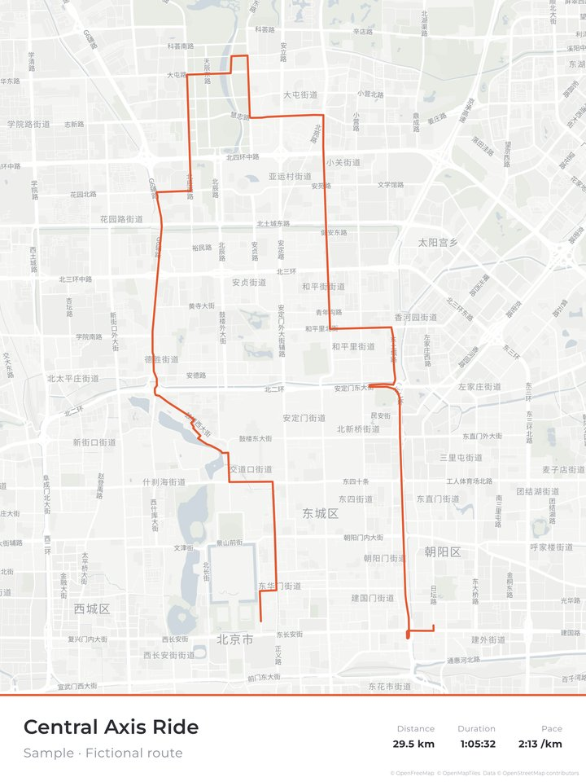
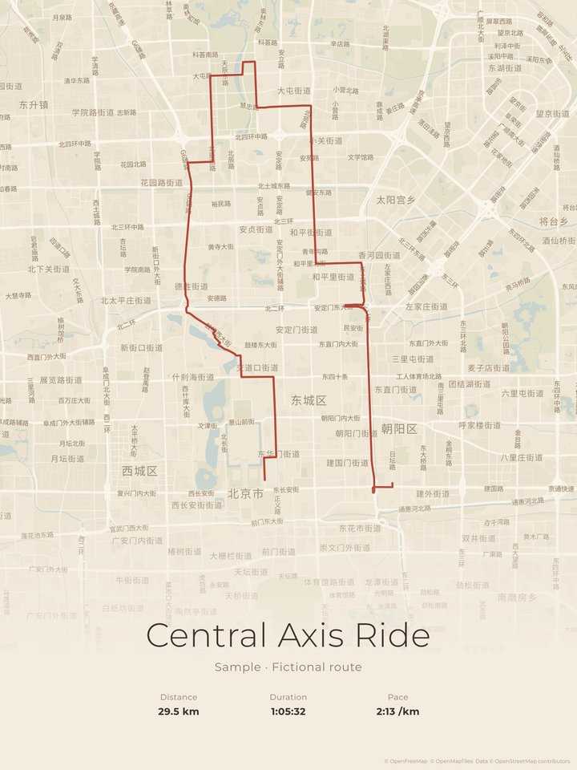
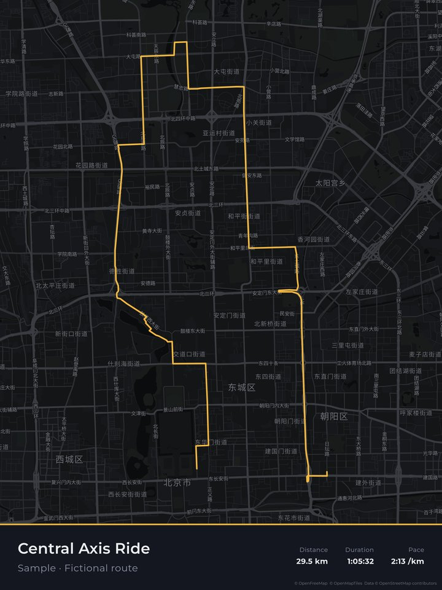
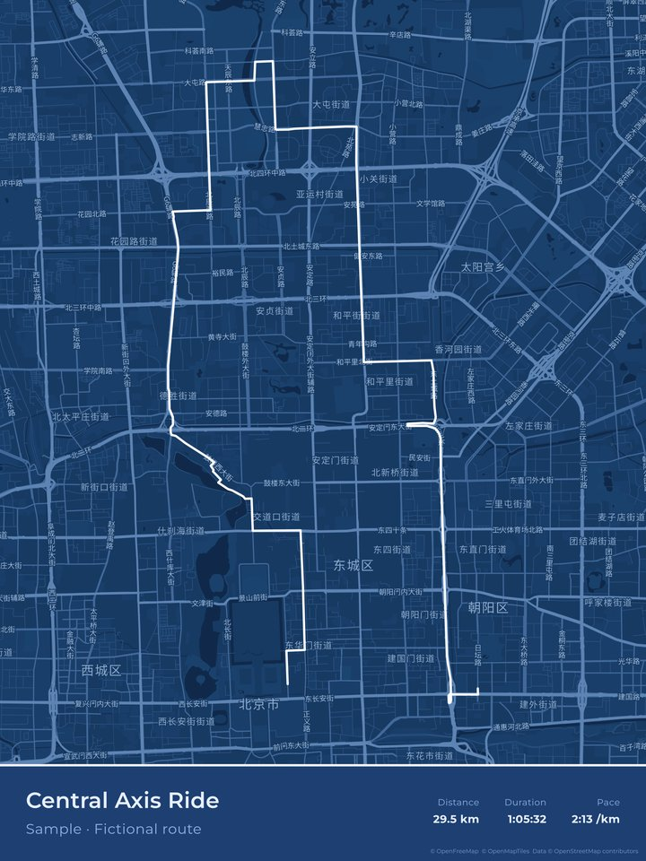

# gpx-route-poster

一个完全本地、免费的 GPX 路线海报生成器：无需登录、无需付费、无水印。
A fully local, free GPX route poster maker: no login, no payment, no watermark.

| light | paper | dark | blueprint |
|---|---|---|---|
|  |  |  |  |

示例使用虚构路线 `samples/beijing-fictional-ride.gpx`。
Screenshots use the fictional sample route.

## 功能 / Features
- 上传 GPX（支持多条轨迹叠加，可多色）/ GPX upload, multiple tracks overlaid, optional multi-colour
- 矢量底图（MapLibre + OpenFreeMap）：5 种底图风格，外加 4 种无底图网格风格；地图可拖动、缩放 / Vector basemap with 5 styles plus 4 grid-only styles; drag and zoom
- 地名和路名标注，可开关，可选中文、当地语言或英文 / Place and road labels (toggle; Chinese, local or English)
- 3 种版式：底栏、居中、经典。标题、副标题、日期、地点、各项数据均可编辑或隐藏 / 3 layouts (bar, centered, classic); every text field editable and hideable
- 高程剖面图，平滑程度可调 / Elevation profile with adjustable smoothing
- 导出 300 DPI 的 PNG 或 PDF，尺寸 30×40 至 50×70 cm（最大 5906×8268 px），横竖版均可；导出时底图自动提高缩放级别 / 300 DPI PNG and PDF export, 30×40 to 50×70 cm, portrait or landscape; higher basemap zoom on export

## 用法 / Usage
- macOS：双击 `start.command`。Linux/macOS 终端：`./start.sh`。需要 `python3`。
  macOS: double-click `start.command`. Terminal: `./start.sh`. Requires `python3`.
- 脚本会启动 `python3 -m http.server`，只监听 127.0.0.1，并自动打开浏览器。
  The script serves the folder on 127.0.0.1 and opens your browser.
- 无头批量导出（可选）/ Headless export (optional):
  ```
  cd tools && npm install
  node export.js out.png '{"size":"50x70","style":"浅灰 Light","layout":"bar","title":"My Ride"}' ../samples/sample-loop-a.gpx
  ```
  需要本机安装 Chrome；可用环境变量 `CHROME=/path/to/chrome` 指定路径。
  Needs a local Chrome; set `CHROME=/path/to/chrome` if needed.

## 已知限制 / Known limitations
- 底图需要联网，依赖 OpenFreeMap 的可用性。网格风格可以离线使用。
  Basemap needs internet access and depends on OpenFreeMap. Grid styles work offline.
- 大尺寸导出很耗内存和 GPU，低配设备可能较慢或失败。浏览器的画布上限约为 8192 px，超过时底图会被略微放大。
  Large exports are memory and GPU heavy. Canvas is limited to about 8192 px, so the map is slightly upscaled beyond that.
- PDF 内嵌的是 JPEG 位图，不是矢量。
  PDF embeds a JPEG raster, not vectors.
- 只支持 GPX，不支持 FIT 或 TCX，也不对接任何运动平台账号。
  GPX only: no FIT/TCX and no fitness-platform integration.
- 轨迹画在标注上层，可能遮住部分路名。
  The route is drawn above labels and may cover some road names.
- 中文字体为 GB2312 子集，生僻字会回退到系统字体。
  The CJK font is a GB2312 subset; rare characters fall back to system fonts.

## 许可 / License
MIT (c) 2026 Paul Lv. 第三方组件见 / Third-party components: [THIRD_PARTY_NOTICES.md](THIRD_PARTY_NOTICES.md)
